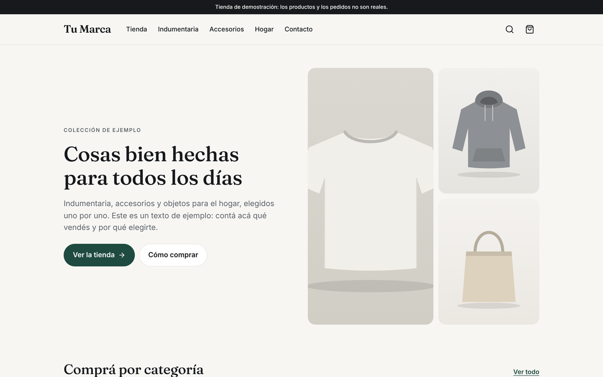
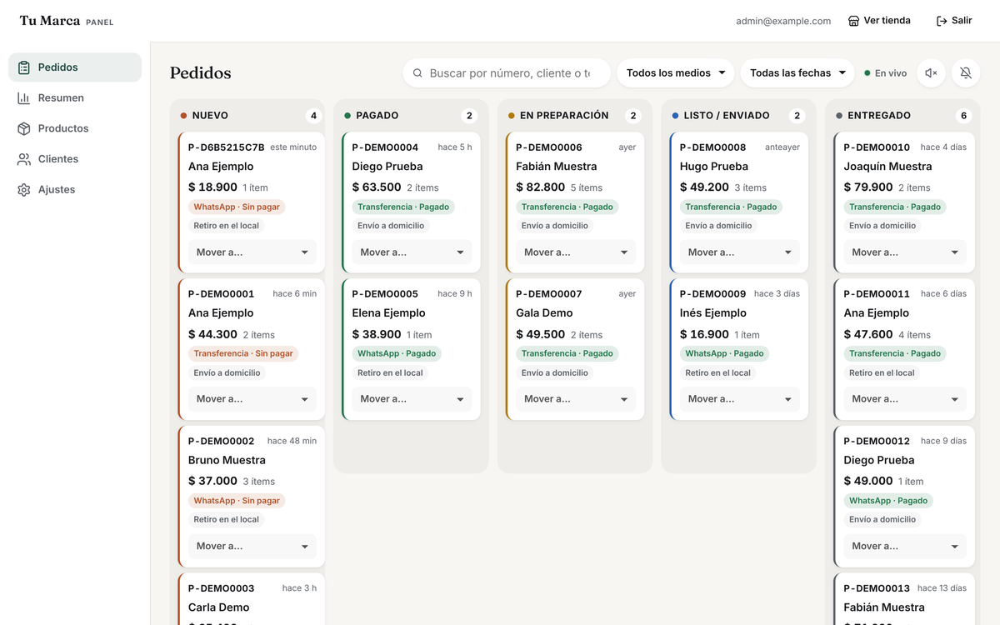
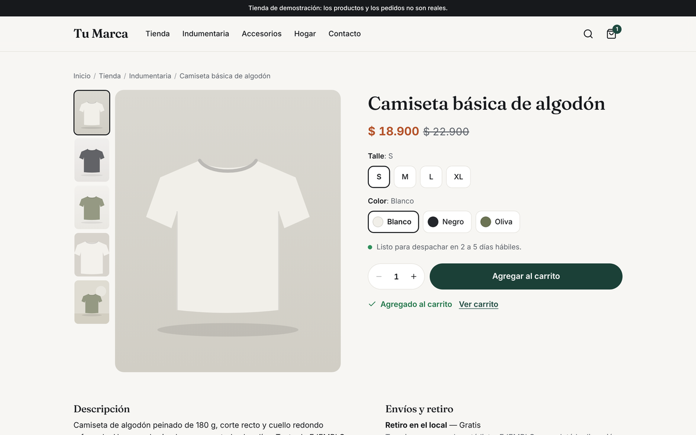
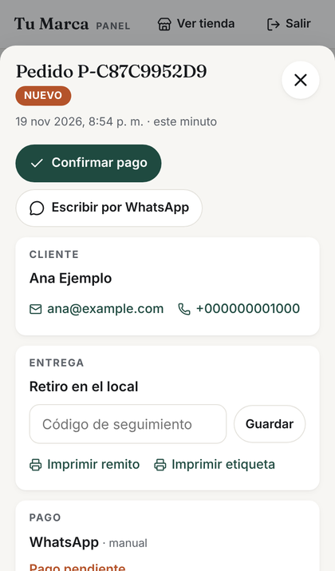

[English](README.md) · **Español**

# Cerebro Web

**La web de un negocio, tuya, en un solo repositorio: una tienda que funciona, un panel de gestión
que recibe los pedidos en un tablero kanban y un «cerebro» que les explica a los agentes de IA
cómo construirla y hacerla crecer.**

Código abierto (MIT), genérica y sin atarse a ninguna plataforma. Hecha con Next.js; corre con
`next start` en cualquier servidor Node, en Docker o en Vercel.

[](https://vercel.com/new/clone?repository-url=https://github.com/FacundoEquiss/cerebro-web)
&nbsp; o tocá **Use this template** arriba de todo en la página del repositorio.

| Tienda | Panel de gestión |
|---|---|
|  |  |
|  |  |

## Por qué existe

Un negocio chico que quiere vender por internet suele alquilar una tienda hospedada —Shopify,
Tiendanube, WooCommerce y similares— y vivir dentro de sus límites, comisiones y plantillas. Hoy
un agente de IA puede construir y mantener una web de verdad para ese negocio, **si** arranca de
algo que ya funciona y de instrucciones claras. Cerebro Web es ese punto de partida:

- **El dueño no programa.** Para cada web nueva le dice a un agente:

  > **«Adaptá esto a mi negocio siguiendo el cerebro.»**

- **El agente** lee [`AGENTS.es.md`](AGENTS.es.md), después el cerebro (`cerebro/`) y sigue
  [`GETTING-STARTED.es.md`](GETTING-STARTED.es.md): marca, productos, fotos, base de datos, pagos,
  legales, dominio y buscadores.
- **Todo queda en tus manos**: el código, los datos y los clientes. Sin abono mensual a una
  plataforma de tiendas.

## Qué trae

**1. La tienda** — portada, tienda con filtros y orden, categorías, página de producto (galería,
elección obligatoria de talle y color, stock, datos estructurados), carrito, checkout, página del
pedido con comprobante firmado, búsqueda, contacto y plantillas de legales. Pensada primero para
el celular, accesible, rápida y renderizada en el servidor (todo el contenido está en el HTML sin
JavaScript).

**2. El panel de gestión (`/admin`)** — lo que reemplaza a la plataforma hospedada:

- **Kanban de pedidos**: Nuevo · Pagado · En preparación · Listo / Enviado · Entregado (Cancelado,
  plegado aparte). Las tarjetas se arrastran con el ratón, se mueven con el menú «Mover a…» en el
  celular o con el teclado. Cada movimiento queda en el historial del pedido.
- **Recepción en vivo**: los pedidos nuevos aparecen solos, con un contador en la pestaña, un
  sonido opcional, la notificación del navegador y un correo al dueño.
- **Detalle del pedido**: ítems, cliente, entrega, pago, línea de tiempo, notas internas,
  confirmar un pago a mano, cancelar con motivo, imprimir remito o etiqueta y escribirle al
  cliente por WhatsApp con un mensaje armado según el estado.
- **Resumen de ventas**, **productos** (crear, editar, fotos achicadas a WebP en el navegador,
  stock editable en la lista), **clientes** (armados a partir de los pedidos) y **ajustes** de
  sólo lectura.
- Ingreso sin proveedor externo: contraseñas con hash scrypt en una variable de entorno y cookie
  de sesión firmada.

**3. El cerebro (`cerebro/`)** — un mapa mental con 316 nodos accionables sobre cómo construir,
lanzar y hacer crecer la web de un negocio: estrategia, tienda, checkout, SEO, buscadores con IA,
medición, publicidad, seguridad, calidad y trabajo con agentes. Se publica aparte en
<https://cerebro-web-negocios.vercel.app> y este proyecto lo cumple.

**Todo se puede cambiar** detrás de interfaces chicas ([`docs/adapters.es.md`](docs/adapters.es.md)):

| Adaptador | Opciones | Por defecto |
|---|---|---|
| Datos (catálogo + pedidos) | `json` · `supabase` · `postgres` | `json` |
| Pagos | `manual` (transferencia / WhatsApp) · `mercadopago` · `stripe` | `manual` |
| Correo | `console` · `resend` · `smtp` | `console` |
| Fotos | `local` · `supabase` | `local` |
| Antibots | `none` · `turnstile` | `none` |

La tienda y el panel leen y escriben **sólo a través de los adaptadores**, así un CRM externo
puede reemplazar al panel.

## Correrla en tu máquina

Necesita Node 22.

```bash
git clone https://github.com/FacundoEquiss/cerebro-web mi-tienda
cd mi-tienda
npm install
npm run dev
```

Abrí <http://localhost:3000> para la tienda y <http://localhost:3000/admin> para el panel. Sin
configurar nada corre en **modo demo**: catálogo de demostración, pedidos de ejemplo en todos los
estados y un usuario demo de sólo lectura con sus credenciales a la vista en la pantalla de
ingreso.

Para usar el panel de verdad en tu máquina, creá tu usuario:

```bash
npm run admin:hash          # pide e-mail y contraseña y muestra la línea para ADMIN_USERS
cp .env.example .env.local  # pegá ahí ADMIN_USERS y ADMIN_SESSION_SECRET
```

En modo `json` local, los pedidos, el stock y los productos editados se guardan en `.data/` (que
nunca se commitea).

### Con Docker

```bash
docker build -t mi-tienda --build-arg NEXT_PUBLIC_SITE_URL=https://www.example.com --build-arg ALLOW_INDEXING=1 .
docker run -p 3000:3000 --env-file .env -v datos-tienda:/data mi-tienda
```

Otras formas de hospedarla (un VPS con un gestor de procesos, Vercel):
[`docs/deploy.es.md`](docs/deploy.es.md).

## De la demo a cobrar de verdad

El checklist completo y ordenado —qué hace el agente y qué sólo puede hacer el dueño— está en
[`GETTING-STARTED.es.md`](GETTING-STARTED.es.md). La versión corta:

1. **Marca y reglas**: `config/brand.ts` (nombre, colores, contacto, país, moneda, idioma) y
   `config/commerce.ts` (envíos, mínimos, plazos, datos bancarios).
2. **Productos**: reemplazar el catálogo de demostración (`content/products.json`) y sus imágenes.
3. **Datos**: crear una base, correr `db/schema.sql` y poner `DATA_SOURCE=supabase` o `postgres`.
   Los pedidos se guardan, el stock baja y el panel guarda los cambios.
4. **Secretos**: `ORDER_SECRET`, `ADMIN_USERS`, `ADMIN_SESSION_SECRET` y `DEMO_MODE=false`. En
   producción el servidor se niega a arrancar sin `ORDER_SECRET` (cargalo en las variables de
   entorno del hosting; en Vercel, antes del primer despliegue).
5. **Pagos**: seguir con `manual`, o `PAYMENT_PROVIDER=mercadopago` / `stripe` con el secreto de su
   webhook — y hacer un pago real de punta a punta antes de anunciar nada.
6. **Salir**: `APP_ENV=production`, tu dominio en `NEXT_PUBLIC_SITE_URL`, los textos legales
   reales y recién entonces `ALLOW_INDEXING=1`.

La pantalla **Ajustes** del panel lista lo que todavía falta.

## Comandos

| Comando | Qué hace |
|---|---|
| `npm run dev` | Servidor de desarrollo |
| `npm run build` / `npm start` | Build y servidor de producción |
| `npm run check` | Sin rastros de una marca privada en el repo; diccionarios parejos |
| `npm run typecheck` | TypeScript estricto |
| `npm test` | Pruebas unitarias (Vitest), con el SQL real sobre un PostgreSQL en proceso |
| `npm run test:e2e` | Pruebas de punta a punta (Playwright) contra el build de producción, en celu y compu |
| `npm run admin:hash` | Crea la línea de un usuario para `ADMIN_USERS` |
| `npm run brain` | Regenera el sitio estático del cerebro en `cerebro/dist/` |
| `npm run images` / `npm run db:seed` | Redibuja las imágenes de demo / regenera `db/seed.sql` |
| `npm run data:export` | Copia los productos editados en local (modo json) a `content/products.json` |
| `npm run screenshots` | Captura cada pantalla clave y falla ante errores de consola |

## Documentación

- [`AGENTS.es.md`](AGENTS.es.md) — instrucciones para agentes de IA (y personas).
- [`GETTING-STARTED.es.md`](GETTING-STARTED.es.md) — de la plantilla a la web de un negocio.
- [`docs/adapters.es.md`](docs/adapters.es.md) — los contratos de los adaptadores y cómo sumar uno.
- [`docs/admin.es.md`](docs/admin.es.md) — el panel: acceso, kanban y recepción en vivo.
- [`docs/deploy.es.md`](docs/deploy.es.md) — hospedaje en cualquier servidor Node, Docker o Vercel.
- [`ROADMAP.md`](ROADMAP.md) · [`CHANGELOG.md`](CHANGELOG.md) · [`CONTRIBUTING.md`](CONTRIBUTING.md) · [`SECURITY.md`](SECURITY.md)
- [`llms.txt`](llms.txt) — el mapa de este repositorio para un agente de IA.

## Stack

Next.js 16 (App Router) · React 19 · TypeScript estricto · Zod · Zustand (carrito) · variables CSS
+ CSS Modules (sin framework de CSS ni librería de UI) · íconos `lucide-react` (ISC) · tipografías
Fraunces e Inter (SIL Open Font License, servidas desde el propio sitio). Sin logos ni marcas de
terceros en la interfaz ni en las imágenes; las imágenes de demo las dibuja un script de este
repositorio.

## Licencia

[MIT](LICENSE) — Copyright (c) 2026 Cerebro Web contributors.
