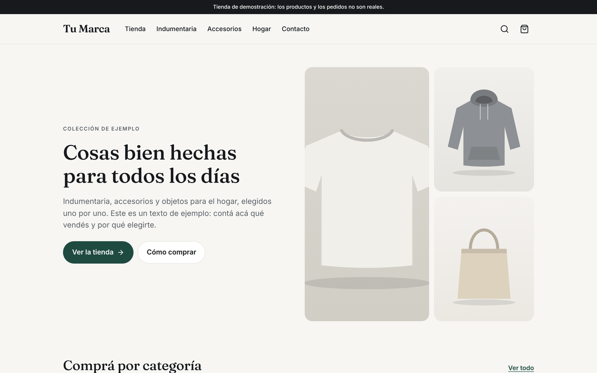
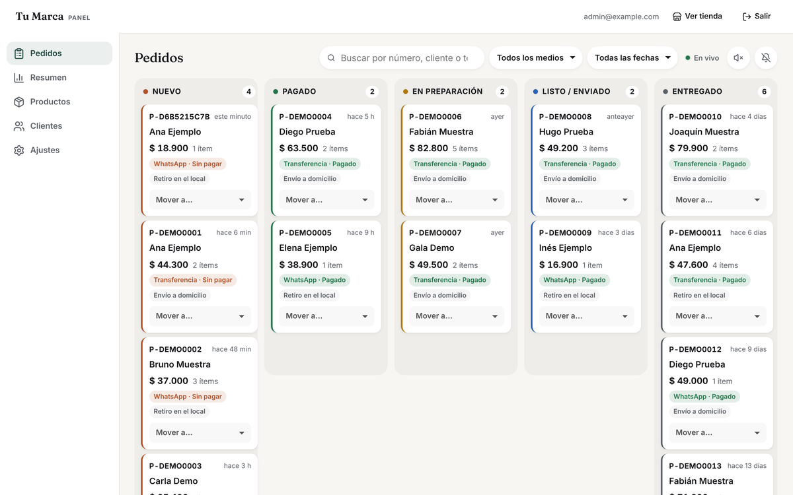
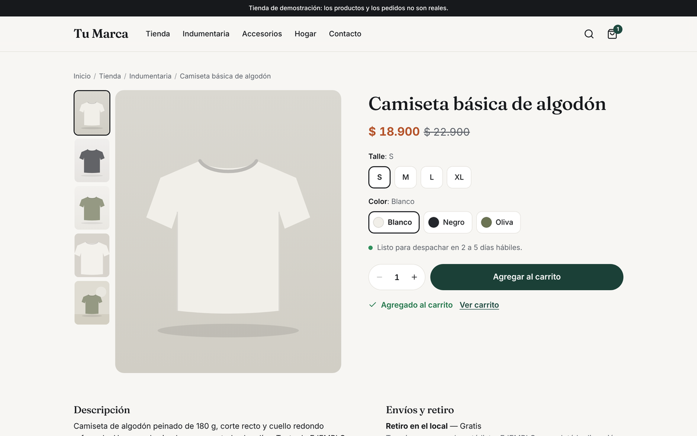
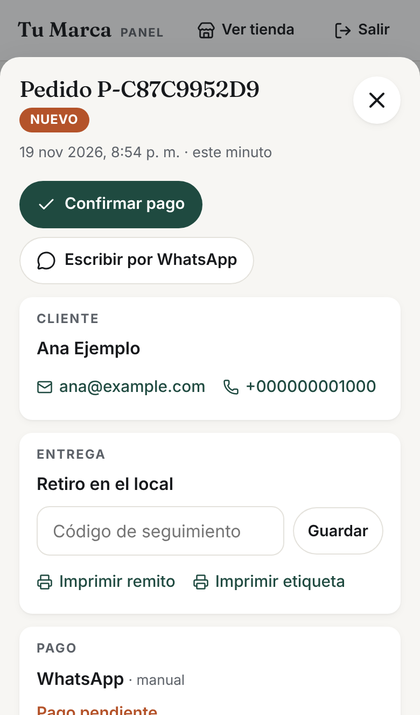

**English** · [Español](README.es.md)

# Cerebro Web

**A business website you own, in one repository: a store that works, an admin panel that receives
your orders on a kanban board, and a "brain" that tells AI agents how to build and grow it.**

Open source (MIT), generic, no platform lock-in. Built with Next.js; runs with `next start` on any
Node server, in Docker, or on Vercel.

[](https://github.com/FacundoEquiss/cerebro-web/actions/workflows/ci.yml)
[](LICENSE)

[](https://vercel.com/new/clone?repository-url=https://github.com/FacundoEquiss/cerebro-web)
&nbsp; or click **Use this template** at the top of the repository page.

| Store | Admin panel |
|---|---|
|  |  |
|  |  |

## Why it exists

A small business that wants to sell online usually rents a hosted store — Shopify, Tiendanube,
WooCommerce and the like — and lives inside its limits, fees and templates. Today an AI agent can
build and maintain a real website for that business, **if** it starts from something that already
works and from clear instructions. Cerebro Web is that starting point:

- **The owner does not program.** For each new site they tell an agent:

  > **"Adapt this to my business following the brain."**
  >
  > *(In Spanish: «Adaptá esto a mi negocio siguiendo el cerebro».)*

- **The agent** reads [`AGENTS.md`](AGENTS.md), then the brain (`cerebro/`), then follows
  [`GETTING-STARTED.md`](GETTING-STARTED.md): brand, products, photos, database, payments, legal
  pages, domain, search engines.
- **You keep everything**: the code, the data, the customers. No monthly fee to a store platform.

## What is inside

**1. The store** — home, shop with filters and sort, categories, product pages (gallery, mandatory
size/colour choice, stock, structured data), cart, checkout, signed order page, search, contact,
legal templates. Mobile first, accessible, fast, server-rendered (everything is in the HTML
without JavaScript).

**2. The admin panel (`/admin`)** — the part that replaces the hosted platform:

- **Orders kanban**: New · Paid · Preparing · Ready / Shipped · Delivered (Cancelled, folded
  apart). Drag cards with the mouse, use the "Move to…" menu on a phone, or the keyboard. Every
  move is written to the order's history.
- **Live reception**: new orders appear on their own, with a counter in the browser tab, an
  optional sound, browser notifications and an e-mail to the owner.
- **Order detail**: items, customer, delivery, payment, timeline, internal notes, confirm a
  payment by hand, cancel with a reason, print a packing slip or a label, message the customer on
  WhatsApp with a text written for the order's status.
- **Sales summary**, **products** (create, edit, photos shrunk to WebP in the browser, inline
  stock), **customers** (built from the orders) and read-only **settings**.
- Sign-in without any external provider: scrypt password hashes in an environment variable and a
  signed session cookie.

**3. The brain (`cerebro/`)** — a mind map with 316 actionable nodes on how to build, launch and
grow a business website: strategy, store, checkout, SEO, AI search, measurement, ads, security,
quality, working with agents. It is published on its own at
<https://cerebro-web-negocios.vercel.app> and this project follows it. (The brain is in Spanish;
its translation is on the roadmap.)

**Everything is swappable** behind small interfaces ([`docs/adapters.md`](docs/adapters.md)):

| Adapter | Options | Default |
|---|---|---|
| Data (catalogue + orders) | `json` · `supabase` · `postgres` | `json` |
| Payments | `manual` (bank transfer / WhatsApp) · `mercadopago` · `stripe` | `manual` |
| E-mail | `console` · `resend` · `smtp` | `console` |
| Photo storage | `local` · `supabase` | `local` |
| Antibot | `none` · `turnstile` | `none` |

The store and the panel read and write **only through the adapters**, so an external CRM can
replace the panel.

## Run it locally

Needs Node 22.

```bash
git clone https://github.com/FacundoEquiss/cerebro-web my-store
cd my-store
npm install
npm run dev
```

Open <http://localhost:3000> for the store and <http://localhost:3000/admin> for the panel. With
nothing configured it runs in **demo mode**: a demo catalogue, example orders in every status, and
a read-only demo user whose credentials are shown on the login screen.

To use the panel for real on your machine, create your own user:

```bash
npm run admin:hash          # asks for e-mail and password, prints the line for ADMIN_USERS
cp .env.example .env.local  # paste ADMIN_USERS and ADMIN_SESSION_SECRET there
```

In local `json` mode, orders, stock and product edits are saved to `.data/` (never committed).

### With Docker

```bash
docker build -t my-store --build-arg NEXT_PUBLIC_SITE_URL=https://www.example.com --build-arg ALLOW_INDEXING=1 .
docker run -p 3000:3000 --env-file .env -v store-data:/data my-store
```

More ways to host it (a VPS with a process manager, Vercel): [`docs/deploy.md`](docs/deploy.md).

## From demo to selling for real

The full, ordered checklist — what the agent does and what only the owner can do — is in
[`GETTING-STARTED.md`](GETTING-STARTED.md). The short version:

1. **Brand and rules**: `config/brand.ts` (name, colours, contact, country, currency, language)
   and `config/commerce.ts` (shipping, minimums, lead times, bank details).
2. **Products**: replace the demo catalogue (`content/products.json`) and its placeholder images.
3. **Data**: create a database, run `db/schema.sql`, set `DATA_SOURCE=supabase` or `postgres`.
   Orders are stored, stock decreases, the panel saves.
4. **Secrets**: `ORDER_SECRET`, `ADMIN_USERS`, `ADMIN_SESSION_SECRET`, `DEMO_MODE=false`. In
   production the server refuses to start without `ORDER_SECRET` (set it in the hosting's
   environment variables — on Vercel, before the first deploy).
5. **Payments**: keep `manual`, or set `PAYMENT_PROVIDER=mercadopago` / `stripe` with its webhook
   secret — and make one real payment end to end before announcing anything.
6. **Go live**: `APP_ENV=production`, your domain in `NEXT_PUBLIC_SITE_URL`, real legal texts,
   then `ALLOW_INDEXING=1`.

The **Settings** screen of the panel lists what is still missing.

## Commands

| Command | What it does |
|---|---|
| `npm run dev` | Development server |
| `npm run build` / `npm start` | Production build / server |
| `npm run check` | No trace of a private brand in the repo; dictionaries in step |
| `npm run typecheck` | TypeScript, strict |
| `npm test` | Unit tests (Vitest), including the real SQL on an in-process PostgreSQL |
| `npm run test:e2e` | End-to-end tests (Playwright) against the production build, phone and computer |
| `npm run admin:hash` | Create an admin user line for `ADMIN_USERS` |
| `npm run brain` | Rebuild the static brain site into `cerebro/dist/` |
| `npm run images` / `npm run db:seed` | Redraw the demo placeholders / regenerate `db/seed.sql` |
| `npm run data:export` | Copy products edited locally (json mode) back to `content/products.json` |
| `npm run screenshots` | Screenshot every key screen and fail on console errors |

## Documentation

- [`AGENTS.md`](AGENTS.md) — instructions for AI agents (and people) working on a site made with this.
- [`GETTING-STARTED.md`](GETTING-STARTED.md) — from template to a real business website.
- [`docs/adapters.md`](docs/adapters.md) — the adapter contracts and how to add one.
- [`docs/admin.md`](docs/admin.md) — the admin panel: access, kanban, live reception.
- [`docs/deploy.md`](docs/deploy.md) — hosting on any Node server, Docker or Vercel.
- [`ROADMAP.md`](ROADMAP.md) · [`CHANGELOG.md`](CHANGELOG.md) · [`CONTRIBUTING.md`](CONTRIBUTING.md) · [`SECURITY.md`](SECURITY.md)
- [`llms.txt`](llms.txt) — the map of this repository for an AI agent.

## Stack

Next.js 16 (App Router) · React 19 · TypeScript (strict) · Zod · Zustand (cart) · CSS variables +
CSS Modules (no CSS framework, no UI library) · `lucide-react` icons (ISC) · Fraunces and Inter
fonts (SIL Open Font License, self-hosted at build time). No third-party logos or trademarks in
the UI or the images; the demo images are drawn by a script in this repository.

## License

[MIT](LICENSE) — Copyright (c) 2026 Cerebro Web contributors.
